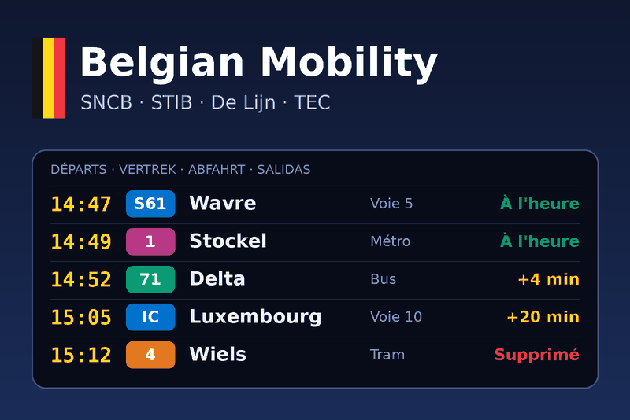

# Belgian Mobility — Gladys Assistant integration

External integration for [Gladys Assistant](https://gladysassistant.com) that
brings the public transport of **all of Belgium** into your smart home: live
departures, delays, cancellations and platforms of your train stations and of
your metro, tram and bus stops, plus the disruptions of the SNCB rail network.



| Operator    | Covers                              | Source                                                 |
| ----------- | ----------------------------------- | ------------------------------------------------------ |
| SNCB / NMBS | Trains: platforms, delays, cancels  | [iRail](https://docs.irail.be) (open API)              |
| STIB / MIVB | Brussels metro, trams and buses     | [Transitous](https://transitous.org) (open data, GTFS) |
| De Lijn     | Flemish trams and buses (real time) | [Transitous](https://transitous.org) (GTFS + GTFS-RT)  |
| TEC         | Walloon metro, trams and buses (RT) | [Transitous](https://transitous.org) (GTFS + GTFS-RT)  |

**No account, no API key**: both sources are free and open. Cloud integration
(`"transports": ["cloud"]`), Gladys **5.1.0 or later**, texts in **English,
French, German and Spanish**.

User documentation (re-hosted by Gladys, linked from the Configuration screen):
[English](docs/en.md) · [Français](docs/fr.md) · [Deutsch](docs/de.md) ·
[Español](docs/es.md).

## Features

**Devices** — one per followed stop (`stops` config field, optionally limited
to some lines), polled every minute or slower:

| Feature                     | Category / type      | Unit    |
| --------------------------- | -------------------- | ------- |
| Next departure in           | `duration / integer` | minutes |
| Delay of the next departure | `duration / integer` | minutes |
| Next departure (summary)    | `text / text`        | —       |

plus an optional **SNCB network** device (latest disruption).

**Scene triggers** — fired once per trip, never once per poll, and never
replayed after a restart:

| Key                   | When                                                      |
| --------------------- | --------------------------------------------------------- |
| `departure_delayed`   | a departure is late by at least `delay_threshold` minutes |
| `departure_cancelled` | a departure is cancelled                                  |
| `departure_imminent`  | a departure is `imminent_minutes` away ("time to leave")  |
| `network_disruption`  | a new disruption or planned works on the SNCB network     |

Filters: stop, line (`71`, `IC`), precise train (`IC 2113`), kind of
disruption. Variables: `line`, `vehicle`, `destination`, `stop_name`,
`operator`, `mode`, `scheduled_time`, `expected_time`, `delay_minutes`,
`minutes`, `platform` (and `title`, `description`, `type` for disruptions).

**Scene actions**:

| Key                  | Does                                                    | Main outputs                                              |
| -------------------- | ------------------------------------------------------- | --------------------------------------------------------- |
| `get_next_departure` | next departure of a stop (line / direction filter)      | `found`, `vehicle`, `minutes`, `delay_minutes`, `summary` |
| `plan_train_journey` | next SNCB train between two stations, now or at `HH:MM` | `found`, `train`, `departure_time`, `arrival_time`...     |
| `get_network_status` | is the SNCB network disrupted?                          | `disrupted`, `disruption_count`, `summary`                |

**Dashboard widgets**: `departures` (departure board of a stop, chosen in the
widget settings, with delay / cancellation badges and a refresh button) and
`network_status` (current disruptions and planned works).

**Configuration screen buttons**: `search_stop` (finds the identifier of any
Belgian stop) and `test_connection`.

## Project structure

```
index.js                     SDK wiring only (handlers registered before connect())
src/config.js                defaults (mirror the manifest) + `stops` parsing
src/i18n.js                  every user-facing text, in en / fr / de / es
src/http.js                  JSON client: User-Agent, throttling, timeout, injectable fetch
src/providers/irail.js       SNCB: stations, liveboard, disturbances, connections
src/providers/transitous.js  STIB, De Lijn, TEC: stop search, stop times
src/mobility.js              resolved stops + departures cache (30 s)
src/events.js                scene trigger detection (once per trip, seeded at start)
src/devices/                 stop and network devices, discovery, poll dispatch
src/scenes.js                scene actions
src/widgets.js               dashboard widgets
src/actions.js               Configuration screen buttons
docs/{en,fr,de,es}.md        user documentation
test/                        node --test, against the SDK's fake Gladys and recorded API answers
```

## Development

```bash
npm install
npm test               # node --test (never touches the network: test/fixtures/)
npm run lint           # ESLint
npm run format:check   # Prettier
npx github:GladysAssistant/integration-store .   # store admission checks
```

Run it against a Gladys instance:

```bash
GLADYS_HOST_API_URL="http://localhost:1443" \
GLADYS_INTEGRATION_TOKEN="<token>" \
GLADYS_INTEGRATION_SELECTOR="belgian-mobility" \
LOG_LEVEL=debug npm start
```

## Release

Describe the changes under `## [Unreleased]` in [`CHANGELOG.md`](CHANGELOG.md),
then **Actions → Release → Run workflow** (`patch`, `minor` or `major`): the
workflow bumps the version everywhere, tags, builds the `linux/amd64` +
`linux/arm64` image to `ghcr.io/gboulvin/gladys-belgianmobility` and publishes
the GitHub Release. The repository carries the `gladys-assistant-integration`
topic, so the store indexer picks up each new version.

## Credits

- [iRail](https://irail.be) — the open API of the Belgian railways.
- [Transitous](https://transitous.org) — community-run, open public transport
  routing for Europe, built on the open data of the operators.
- Started from the official
  [Gladys integration template](https://github.com/GladysAssistant/integration-template-js).

Not affiliated with SNCB/NMBS, STIB/MIVB, De Lijn or TEC.

## License

Apache-2.0
